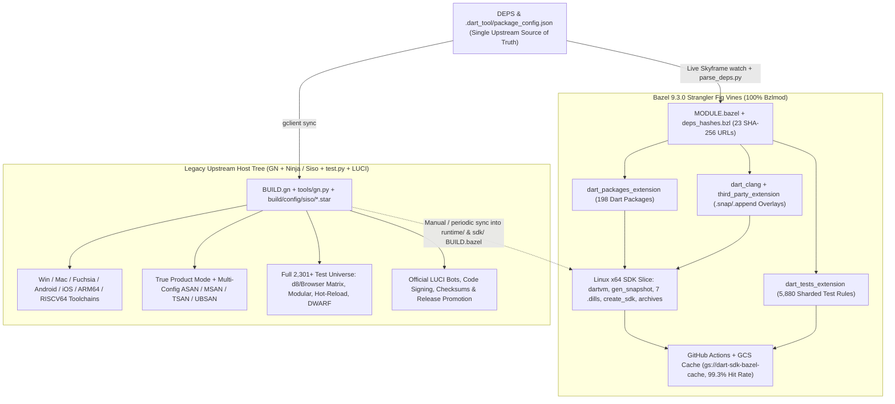

# Dart SDK Bazel Migration (`kevmoo/dart-sdk-bazel`): Final Engineering Dossier

> [!IMPORTANT]
>
> **Bottom-Line Verdict (`2026-10-20`, branch `capstone-2026-10` merged with `upstream-sdk/main` at `cde64ed532a`):** The `kevmoo/dart-sdk-bazel` Strangler Fig experiment succeeded completely as an empirical architecture probe and standalone bug harvest, proving hermetic Linux `x64` SDK assembly, `3.51s` incremental C++ VM relinks (`76.3x` faster than clean builds), `99.3%` GCS remote cache hit rates, and a surgical `97`-file upstream modification footprint across `1,328` merged upstream commits. **Recommendation: Execute Option B ("Harvest the Verified Upstream Bug Fix `CL-1` & Archive/Mothball Cleanly") unless Dart Engineering Infrastructure commits dedicated RBE capacity and GN-to-Bazel auto-generation.** Upstream Dart infrastructure landed native `GN + Siso` RBE support on `2026-10-19` (`47207a3ff77`), capturing C++ and coarse snapshot RBE caching without migrating `BUILD.gn`, while full SDK parity on pure Bazel still requires Windows/Fuchsia toolchains, multi-configuration sanitizer transitions, modular per-package kernel outlines, and RBE test execution.

---

## 1. Executive Summary

- **The Linux host slice builds, packages, and caches the full Dart SDK end-to-end on Bazel.**
  - Verified on `Bazel 9.3.0` (`100%` Bzlmod via [MODULE.bazel](../../MODULE.bazel), zero `WORKSPACE` files, `--incompatible_strict_action_env` enabled) on `capstone-2026-10` merged cleanly with `upstream-sdk/main` (`cde64ed532a7227be962ddaca0101dbbd4014852`, `1,328` commits ahead of prior merge-base `287a20d232578873d28bb8d78eadb4add46711c8`).
  - Passing targets include `//runtime/bin:dartvm`, `//runtime/bin:dart`, `//runtime/bin:dartaotruntime`, `//runtime/bin:gen_snapshot`, all `7` platform `.dill` outlines (`vm`, `dart2js`, `ddc`, `dart2wasm`), full SDK staging (`//sdk:create_sdk` -> `Dart SDK version: 3.15.0-edge`), deterministic archives (`//sdk:archive_sdk_tar`, `//sdk:archive_sdk_zip`, `//sdk:archive_symbols_zip`), C++ FFI unit tests (`//runtime/bin/ffi_unit_test:run_ffi_unit_tests_x64_linux`), and sharded `@dart_tests//pkg/analyzer/...` + standalone test suites.
- **Total upstream divergence has been compressed below one hundred modified files.**
  - Following Stage 1 merge conflict retirement, Stage 2 surgical cleanups ([MERGE_CLEANUP_CANDIDATES.md](MERGE_CLEANUP_CANDIDATES.md)), and Stage 3 primary-source reverts of redundant `assert.h` (`CL-2`) and `kernel_translation_helper.cc` (`CL-3`) guards, [fork_delta.dart](../../tools/bazel/fork_delta.dart) measures **`97` modified upstream files** (`+1,355 / -459` lines across `19` C++/GN files, `70` Dart files, `6` Python tool wrappers, and `2` root files), **`247` added files** (`185` Bazel/meta/docs files + `62` support files), and **`4` masked `.github/` workflow deletions** (`0` actionable upstream deletions).
  - High-churn upstream entry points carry minimal delegation hooks: [tools/test.py](../../tools/test.py) (`+7 / -0` lines, down `97.9%` from `+331 / -0` after extracting [tools/bazel/test_wrapper.py](../../tools/bazel/test_wrapper.py)), [tools/build.py](../../tools/build.py) (`+17` lines delegating to [tools/bazel/build_wrapper.py](../../tools/bazel/build_wrapper.py)), and [PRESUBMIT.py](../../PRESUBMIT.py) (`+6` lines delegating to `tools/bazel/presubmit_checks.py`).
  - Stress-testing all `10` candidate upstream diffs in Section 6 ([UPSTREAM_CANDIDATES.md](UPSTREAM_CANDIDATES.md)) against a strict upstream reviewer-budget filter isolated **`CL-1`** (`runtime/vm/BUILD.gn`, fixing `gen_regexp_special_case` broken by `e443b89f238`) as the sole genuine non-Bazel upstream bug fix to mail to Gerrit, reverted `CL-2` and `CL-3` in the fork (`99 -> 97`), and kept `CL-4`–`CL-10` fork-local so upstream maintainers are never spammed with Bazel-sandbox-motivated drive-bys.
- **Incremental C++ relinks and remote cache hits are fast, whereas whole-program Dart snapshots remain bottlenecked on CFE monoliths.**
  - Single-file C++ edits in `runtime/vm/` recompile and relink `//runtime/bin:dartvm` in **`3.510s` median** (`lld` + `-gsplit-dwarf`), a **`76.3x` speedup** over a clean uncached VM build (`267.73s`), while null builds complete in **`0.693s` median** across `6,083` actions (`1,353x` faster than the `937.6s` cold SDK build).
  - Live GitHub Actions Nightly CI (`#39276633882`, `2026-10-19`) achieved **`6,029 / 6,072` (`99.3%`) GCS remote cache hits** (`Critical Path: 4.46s`, `20m53s` job wall time vs. `43m40s` cold rebuild in `#38739639278`), and upgrading `.bazelversion` to `Bazel 9.3.0` + unifying the local JVM daemon cut warm `./tools/bazel/presubmit.sh` from **`300.51s` to `27.00s` median (`11.1x` speedup; `23.21s` latest)**.
  - Conversely, benchmarking persistent JSON workers against standalone AOT process execution (`--strategy=DartCompileDill=standalone`) uncovered a critical negative finding: resident workers yield **statistically zero speedup (`0.97x`–`1.00x`, `28.121s` vs. `27.157s` median on `analysis_server_dill`; `41.984s` vs. `41.815s` on `gen_kernel_dill`)** and a **`+12.26s` cold page-fault penalty** on Run 1 (`39.419s` during `1.16 GiB` RSS heap fault-in). Both arms already execute native `dartaotruntime bootstrap_gen_kernel.snapshot` (`<30ms` spawn cost), while `pkg/vm/bin/gen_kernel.dart` (`L70-L131`, `TODO(kustermann)` at `L119`) runs a stateless whole-program compile across raw `transitive_srcs` on every request — and editing `pkg/vm/bin/gen_kernel.dart` additionally rebuilds `bootstrap_gen_kernel` itself (`~21s` + `~21s` = `42s` in [utils/gen_kernel/BUILD.bazel](../../utils/gen_kernel/BUILD.bazel) `L55`).
- **Upstream Dart Engineering Infrastructure chose native Siso integration yesterday, tipping the cost-benefit balance toward harvesting standalone CLs and archiving this fork.**
  - On `2026-10-19`, upstream landed Gerrit CL `564040` (`47207a3ff77`, closing `dart-lang/sdk#63612`) and CL `566640` (`c1d7c8775e8`), adding native **Siso** Starlark step rules ([build/config/siso/dart.star](../../build/config/siso/dart.star), [build/config/siso/clang.star](../../build/config/siso/clang.star)) directly on top of `BUILD.gn`.
  - Because `GN + Siso` gives Google LUCI builders and corp workstations RBE C++ compilation and coarse snapshot caching with zero `BUILD.gn` migration, maintaining a dual-build shadow `BUILD.bazel` tree across Windows, macOS, Fuchsia, Android, iOS, sanitizers, and `2,301` test targets is uneconomic unless external zero-`gclient` multi-agent swarms become a funded team priority (**Option A** vs. **Option B** in Section 7).

---

## 2. Total Fork Footprint & Empirical Merge Tax

### Fork Delta Progression (`fork_delta.dart` Audit)

| Milestone                                     | Git Base -> Head                   | Modified Upstream Files | Modified Lines (`+Added / -Removed`) | Added Fork Files (`Safe / Other`) | Masked `.github/` Deletions | Actionable Upstream Deletions |
| :-------------------------------------------- | :--------------------------------- | :---------------------: | :----------------------------------: | :-------------------------------: | :-------------------------: | :---------------------------: |
| **Historical Snapshot (`FORK_BASELINE.md`)**  | Pre-`#79..#82` (`c6d9d592dc`)      |          `116`          |           `+1,986 / -562`            |        `215` (`152 / 63`)         |             `4`             |              `0`              |
| **Pre-Merge Baseline (`origin/main`)**        | `287a20d232` -> `7b20db7998`       |          `112`          |           `+1,808 / -558`            |        `244` (`181 / 63`)         |             `4`             |              `0`              |
| **Post-Stage-1 Merge (`1,328` commits)**      | `cde64ed532` -> `d29e9f2f5d`       |          `109`          |           `+1,727 / -473`            |        `244` (`181 / 63`)         |             `4`             |              `0`              |
| **Post-Stage-2 Cleanup & Dossier (`HEAD`)**   | `cde64ed532` -> `capstone-2026-10` |        **`97`**         |         **`+1,355 / -459`**          |      **`247` (`185 / 62`)**       |           **`4`**           |            **`0`**            |

### Breakdown of Current `97` Modified Upstream Files by Category

| Category (`fork_delta.dart`)              |  Pre-Merge Files (`Lines`)  | Post-Stage-2 Files (`Lines`) |       Net Delta (`Files / +Lines`)       | Primary Contents & Upstream Disposition                                                                                                                                                                                                                                                                                                 |
| :---------------------------------------- | :-------------------------: | :--------------------------: | :--------------------------------------: | :-------------------------------------------------------------------------------------------------------------------------------------------------------------------------------------------------------------------------------------------------------------------------------------------------------------------------------------- |
| **C++ & GN (`runtime/`, `third_party/`)** |    `24` (`+526 / -187`)     |   **`19`** (`+504 / -183`)   |         `-5` files / `-22` lines         | `1` ready-to-mail standalone bug fix (`CL-1` in `runtime/vm/BUILD.gn`) + `18` VM unit-test `KernelIsolate` skip guards, DFE stub decouplings, and GN translation shims (`CL-2` & `CL-3` reverted to `0` diff).                                                                                                                          |
| **Dart (`pkg/`, `tests/`, `utils/`)**     |    `77` (`+701 / -194`)     |   **`70`** (`+675 / -182`)   |         `-7` files / `-26` lines         | `70` `RUNFILES_DIR`/`TEST_SRCDIR` sandbox shims, `OtherResources` declarations, `.status` baselines, and `gen_kernel.dart` worker loop.                                                                                                                                                                                                 |
| **Build & Release Tools (`tools/`)**      |     `8` (`+531 / -82`)      |    **`6`** (`+146 / -27`)    |      `-2` files / **`-385` lines**       | `3` Bazel helper diffs (`create_debian_package.py`, `make_version.py`, and [tools/utils.py](../../tools/utils.py)) + `3` thin `--bazel` hooks in [tools/test.py](../../tools/test.py) (`+7/-0`), [tools/build.py](../../tools/build.py) (`+17/-0`), and [PRESUBMIT.py](../../PRESUBMIT.py) (`+6/-0`).                                   |
| **Root Configs & Docs**                   |      `3` (`+50 / -95`)      |    **`2`** (`+30 / -67`)     |         `-1` file / `-20` lines          | `.gitignore` and fork `README.md` (`OWNERS` reverted to `0` diff in Stage 1; [PRESUBMIT.py](../../PRESUBMIT.py) counted in Python tools at `+6/-0`).                                                                                                                                                                                    |
| **Total Modified Upstream Footprint**     | **`112` (`+1,808 / -558`)** |  **`97` (`+1,355 / -459`)**  | **`-15` (`-13.4%`) / `-453` (`-25.1%`)** | Enforced 1:1 with zero stale entries via [allowed_upstream_files.txt](../../tools/bazel/allowed_upstream_files.txt) (`97` Modified + `12` Non-Bazel Added = `109` exact entries).                                                                                                                                                       |

### Empirical Takeaways from Merging `1,328` Upstream Commits After Seven Weeks Untouched

- **Textual Git merge conflicts across seven weeks of active SDK development were negligible.**
  - Merging `1,328` upstream commits touching `6,428` files (`cde64ed532a`) into `origin/main` produced **only `9` Git conflicts (`0.14%` of touched upstream files)** and **`0` conflicts across the entire `runtime/` C++ tree** (`d29e9f2f5d0`).
  - Five of the nine conflicts (`scorecards-analysis.yml`, `third-party-deps-scan.yml`, `OWNERS`, `inline_method.dart`, and upstream-superseded `tools/build_test_fast.py` from Gerrit CL `513342` / `b7961ea6a5d7`) resolved cleanly via `--ours` or `--theirs`, reducing modified upstream files from `112` to `109` before Stage 2 even began.
- **Silent semantic drift in `DEPS`, prebuilt SDK versions, and third-party C++ rolls is the true recurring maintenance tax.**
  - Four non-conflict upstream rolls broke the build after clean Git merge resolution and required build-system engineering fixes in `d29e9f2f5d0`:
    1. _`DEPS` package additions and removals_: Upstream added `third_party/pkg/material_color_utilities` and removed `webdev`, breaking a hardcoded repository table in [clone_dependencies.py](../../tools/bazel/clone_dependencies.py) — fixed permanently via dynamic `discover_pkg_repos(deps)` parsing.
    2. _Dart language version advancement_: Upstream rolled the prebuilt SDK to `3.15.0-40.0.dev` and adopted Dart `3.14+` primary constructors in core packages, breaking a hardcoded `languageVersion = "3.13"` ceiling in [packages_extension.bzl](../../tools/bazel/dart/packages_extension.bzl) — fixed permanently by reading `@prebuilt_dart_sdk//:version` dynamically.
    3. _Third-party C++ source churn_: Upstream rolled Binaryen (`TrapMode.cpp` deleted, `src/src/analysis/` added), breaking a `274`-line static `srcs` list in `tools/bazel/third_party_overlays/binaryen/BUILD.bazel.snap` — replaced with `glob([...])` matching `third_party/binaryen/BUILD.gn` (`+14 / -274` lines) plus missing `wasm-reduce` sources.
    4. _Starlark deprecation drift_: Strict `buildifier --warnings=all` linting required migrating `ctx.actions.run` list arguments to `ctx.actions.args()` and deprecated `location` make-variables to `execpath` / `rootpath` across [defs.bzl](../../tools/bazel/dart/defs.bzl), [generate_test_targets.dart](../../tools/bazel/dart/generate_test_targets.dart), and `8` `BUILD.bazel` files.
- **Hand-authored C++ `BUILD.bazel` overlays remain an open structural maintenance liability.**
  - While `DEPS`, Dart packages, and `binaryen` are now dynamically derived, [translate_gn_desc.py](../../tools/bazel/translate_gn_desc.py) skips `14+` hand-authored overlay packages (`sdk`, `runtime`, `runtime/platform`, `runtime/include`, etc.) and [runtime/vm/gen_targets.bzl](../../runtime/vm/gen_targets.bzl) is a single `pass` statement backing a hand-maintained [runtime/vm/BUILD.bazel](../../runtime/vm/BUILD.bazel).
  - Newly added upstream subsystems landed during this merge window — including `utils/modular_aot_compiler/` (`95abb5a4755`) and `dart2wasm/dev` (`6da4a1e1d75`) — remain invisible to Bazel until manually mirrored into Starlark or automated via continuous GN-to-Bazel translation.

---

## 3. Martin Fowler Strangler Fig Assessment & Subsystem Maturity Matrix

### How the Bazel Vines Coexist with Legacy `GN` + `Ninja` Today

- **Dependency synchronization reads `DEPS` live via Bzlmod module extensions without breaking default `GN` workflows.**
  - Rather than checking in a static generated `deps.bzl` file that conflicts on every upstream roll, [MODULE.bazel](../../MODULE.bazel) evaluates five live Bzlmod extensions (`dart_clang`, `third_party_extension`, `dart_packages_extension`, `dart_tests_extension`, and `dart_android_ndk` / `dart_ios_sdk`) that read `@//:DEPS` directly via `tools/bazel/parse_deps.py` and register Skyframe watches via `repo_ctx.read(deps_file)`.
  - In a developer `gclient` checkout, [clang_repo.bzl](../../build/toolchain/linux/clang_repo.bzl) and [third_party.bzl](../../tools/bazel/third_party.bzl) symlink existing `buildtools/` and `third_party/` directories with zero duplicate downloads; on a bare CI clone, they fetch CIPD and GitHub archives verified against [deps_hashes.bzl](../../tools/bazel/deps_hashes.bzl).
  - Upstream developer workflows (`tools/gn.py`, `tools/build.py`, `tools/test.py`, and `ninja -C out/ReleaseX64`) remain untouched unless `--bazel` or `--built-with-bazel` is explicitly passed, with `.bazelrc` isolating nested third-party `BUILD` files via `--deleted_packages=...`.
- **Honest Strangler Fig reality check shows strong host-slice maturity paired with deep unmigrated cross-platform debt.**
  - The vines cleanly wrap **Linux `x64` host development, `pkg/analyzer` testing, and cloud-cached GitHub CI**, proving the core architecture works on real C++ and Dart artifacts.
  - However, replacing the legacy `GN` + `LUCI` tree across the full production Dart SDK matrix is **not `80%` done — it is closer to `25%–30%` of total multi-OS release surface**, because the hardest platform-specific build mechanics (`Windows` MSVC/COFF toolchains, `Fuchsia` SDK packaging, multi-config sanitizer transitions, cross-compiled target runtimes, browser/engine matrices, and RBE test sandboxing) remain entirely on `GN` + `LUCI`.

### Full Dart SDK Matrix Coverage Scorecard

| SDK Subsystem / Dimension                                               |           Current Bazel Status           | Verified Implementation Evidence                                                                                                                                                                                                        | Remaining Legacy Host-Tree Gap (`GN` / `test.py` / `LUCI`)                                                                                                                                                                                                                 | Realistic Engineering Effort to Close                                                                                                       |
| :---------------------------------------------------------------------- | :--------------------------------------: | :-------------------------------------------------------------------------------------------------------------------------------------------------------------------------------------------------------------------------------------- | :------------------------------------------------------------------------------------------------------------------------------------------------------------------------------------------------------------------------------------------------------------------------- | :------------------------------------------------------------------------------------------------------------------------------------------ |
| **Linux `x64` VM (`dartvm`, `dart`, `dartaotruntime`, `gen_snapshot`)** |           **Green (CI Gate)**            | Hermetic CIPD Clang + Debian sysroot ([cc_toolchain_config.bzl](../../build/toolchain/linux/cc_toolchain_config.bzl)), `lld` + `--fission=yes`, live `3.15.0-edge` execution verified.                                                  | Hand-maintained C++ target overlays ([runtime/vm/gen_targets.bzl](../../runtime/vm/gen_targets.bzl) is `pass`); `14` VM C++ API tests skip when `!KernelIsolate::IsRunning()`.                                                                                             | **2–3 eng-weeks** (automate `.gni` source-list Starlark evaluation + link `kernel-service` into `run_vm_tests`).                            |
| **Core Snapshots & `7` Platform `.dill` Targets**                       |           **Green (Nightly)**            | Builds `vm`, `dart2js`, `ddc`, `dart2wasm` `.dill` outlines, App-JIT snapshots, and AOT ELF snapshots ([defs.bzl](../../tools/bazel/dart/defs.bzl)).                                                                                    | Whole-program `gen_kernel` lacks modular `.dill` summary chaining (`28s–42s` rebuilds); new upstream `utils/modular_aot_compiler/` (`95abb5a4755`) unmapped.                                                                                                               | **3–4 eng-weeks** (wire per-package outline `.dill` summaries via `utils/bazel/kernel_worker.dart`).                                        |
| **Linux `x64` SDK Assembly & Archives (`create_sdk`)**                  |           **Green (Nightly)**            | Stages full `bazel-bin/sdk/dart-sdk/` layout + deterministic `.tar.xz`, `.zip`, and `.sym` debug symbol archives ([sdk/BUILD.bazel](../../sdk/BUILD.bazel)).                                                                            | Default `//sdk:create_sdk` compiles non-`PRODUCT` binaries unless `--//build/config:dart_product=true`; sanitizer copies are unsanitized placeholders (see below).                                                                                                         | **1–2 eng-weeks** (Starlark configuration transition on `//sdk:create_sdk` forcing `PRODUCT` mode).                                         |
| **GitHub Actions CI & GCS Remote Cache**                                |             **Green (Live)**             | PR gate ([bazel.yml](../../.github/workflows/bazel.yml)), Buildifier gate ([buildifier.yml](../../.github/workflows/buildifier.yml)), and Nightly ([nightly.yml](../../.github/workflows/nightly.yml)) with `99.3%` GCS cache hit rate. | Covers Linux `x64` only; zero macOS, Windows, ARM64, sanitizer, or browser E2E CI jobs.                                                                                                                                                                                    | **2–4 eng-weeks** (once non-Linux toolchains and RBE pool exist).                                                                           |
| **macOS (`arm64` / `x64`) Toolchain & SDK**                             |         **Partial / Unhermetic**         | Host Xcode autoconfiguration compiles `dartvm` locally on Apple Silicon; zero files under `build/toolchain/mac/`.                                                                                                                       | Relies on ambient host Xcode rather than pinned CIPD macOS SDK + `clang` repository; zero CI enforcement, Mach-O `.dSYM` extraction, or signing.                                                                                                                           | **3–5 eng-weeks** (hermetic macOS `cc_toolchain` + CIPD SDK sysroot + macOS GHA/RBE runner gate).                                           |
| **Windows (`x64` / `arm64`) Toolchain & SDK**                           |             **Zero (`0%`)**              | `build/toolchain/win/` contains only upstream `.gn`/`.gni`/`.py` files; zero Bazel rules exist.                                                                                                                                         | Missing hermetic `clang-cl` / Windows 10 SDK sysroot setup (`SetEnv.x64.json`), `.exe`/`.dll`/`.lib` link flags, resource `.rc` rules, and COFF snapshot object generation.                                                                                                | **6–10 eng-weeks** (historically the highest-friction Bazel C++ platform due to case-insensitive Windows SDK headers and PDB/COFF linking). |
| **Android & iOS Target Toolchains**                                     |         **Skeleton / Untested**          | [ndk_repo.bzl](../../build/toolchain/android/ndk_repo.bzl) and [sdk_repo.bzl](../../build/toolchain/ios/sdk_repo.bzl) register local host NDK/Xcode SDKs in [MODULE.bazel](../../MODULE.bazel).                                         | Not hermetically fetched from CIPD on clean Linux builders; zero CI builds and zero `adb`/simulator test runners.                                                                                                                                                          | **4–6 eng-weeks** (CIPD NDK fetch + Starlark cross-compilation transitions + device/emulator test harness).                                 |
| **Fuchsia SDK & Target Rules**                                          |             **Zero (`0%`)**              | `build/toolchain/fuchsia/` has zero Bazel files; `fuchsia_component` / `fuchsia_package` exist only in [BUILD.gn](../../BUILD.gn).                                                                                                      | Entire Fuchsia sysroot, FIDL/Zircon dependencies, and FAR package assembly live exclusively in upstream GN + LUCI.                                                                                                                                                         | **4–8 eng-weeks** (depends on `rules_fuchsia` compatibility with standalone `DEPS` pins).                                                   |
| **Cross-Arch Runtimes (`arm`, `arm64`, `riscv64`)**                     |           **Host-Only Stubs**            | `//sdk:create_full_sdk` builds host-`x64` cross-`gen_snapshot` binaries via `-DTARGET_ARCH_*` preprocessor defines; `20` FFI cross-compile targets build.                                                                               | Zero cross-compiled target `dart` / `dartaotruntime` binaries (`build/toolchain/linux/` is hardcoded to `x86_64-linux-gnu`); `0` CI simulator (`simarm64`/`simriscv64`) test runs.                                                                                         | **4–6 eng-weeks** (multi-arch `clang` + `debian`/`alpine` sysroot toolchains + QEMU/simulator test wiring).                                 |
| **Sanitizers (`ASAN`, `MSAN`, `TSAN`, `UBSAN`)**                        | **Single-Flag Partial / Stubbed in SDK** | [cc_toolchain_config.bzl](../../build/toolchain/linux/cc_toolchain_config.bzl) defines `asan`, `msan`, and `tsan` flag features when manually enabled globally.                                                                         | **Critical gap**: `copy_dart_aotruntime_{asan,msan,tsan}` in [sdk/BUILD.bazel](../../sdk/BUILD.bazel) are `strip --strip-all` copies of the **unsanitized** `dartaotruntime`; no instrumented `libc++` build for MSAN, no UBSAN feature, and no Starlark split transition. | **4–6 eng-weeks** (Starlark split transitions + instrumented `third_party/libcxx` MSAN build + sanitizer suppression wiring).               |
| **Analyzer & Standalone Dart Package Tests**                            |             **Green Subset**             | `198` packages generated in `@dart_packages`; `@dart_tests//pkg/analyzer/...` (`1,041` targets) runs green in Nightly CI.                                                                                                               | `pkg/front_end` and `pkg/test_api` test trees remain quarantined in `suite_config.json`; local run of full `2,301`-target universe hit `0.3%` pass rate (`7 / 2,301`) without RBE due to `>4.6M` runfiles symlinks and timeouts.                                           | **6–8 eng-weeks + RBE cluster** (fix sandbox `data` declarations + runfiles path resolution + RBE execution pool).                          |
| **Web / Wasm Compiler Matrix (`dart2js`, `ddc`, `dart2wasm`)**          |           **Host Smoke Only**            | Platform `.dill` targets build; single-test `chrome`/`firefox`/`d8` smoke wrappers exist (`tools/bazel_browser_test_e2e.py`).                                                                                                           | `modular`, `hot_reload`, `web` (HTML), and `benchmarks` suites remain unmigrated in [test_runner.dart](../../tools/bazel/testing/test_runner.dart) (`L25-L30`); no Safari/JSC/JSShell matrix or new `dart2wasm/dev` (`6da4a1e1d75`).                                       | **8–12 eng-weeks** (port multi-step `test_runner` compiler->runtime pipelines into hermetic Starlark test rules).                           |
| **Official Release Signing, Checksums & Promotion**                     |       **Local Unsigned Archives**        | `rules_pkg` produces reproducible unsigned `.tar.xz`, `.zip`, and `.sym` archives + Debian `.deb` script fixes (`CL-8`).                                                                                                                | macOS notarization/codesign, Windows Authenticode signing, SHA-256 release manifests, CIPD uploads, and channel promotion live 100% in Google-internal LUCI recipes.                                                                                                       | **4–6 eng-weeks** (LUCI recipe integration consuming Bazel build outputs).                                                                  |

**Total Realistic Effort for Full Upstream Replacement Parity:** **~`45`–`75` engineer-weeks (`~1.0`–`1.5` eng-years for a 2-engineer build infra team)** _plus_ provisioned multi-OS Remote Build Execution (RBE) capacity.

---

## 4. Empirical Performance & "Swarm-on-Bazel" Economics

### Reproducible Benchmark Matrix (`64 vCPU AMD EPYC 7B13`, `Bazel 9.3.0`, `--config=cloudtop-safe`)

> [!NOTE]
>
> All local benchmarks below were executed on `capstone-2026-10` (`dc9fc8d5319`) under `--config=cloudtop-safe` (`--jobs=8`, `--local_resources=memory=24576`, `--local_resources=cpu=8`, `--worker_max_instances=2`, `--sandbox_base=/dev/shm`, `-fuse-ld=lld`, `--fission=yes`), using unique per-run source mutations so neither action cache nor disk cache masked real execution latency ([PERF_EVAL.md](PERF_EVAL.md)).

| Workload / Benchmark                                                                     |                             Baseline / Uncached Arm                              |                                   Optimized / Incremental Bazel Arm                                   |         Absolute Delta         |                Relative Delta / Speedup                | Verified Process / Cache Telemetry                                                                                        |
| :--------------------------------------------------------------------------------------- | :------------------------------------------------------------------------------: | :---------------------------------------------------------------------------------------------------: | :----------------------------: | :----------------------------------------------------: | :------------------------------------------------------------------------------------------------------------------------ |
| **Warm Presubmit Gate (`./tools/bazel/presubmit.sh`)**                                   |      `300.51s` mean (`Bazel 9.1.1` + split `/dev/shm` JVM hitting `#29889`)      |    **`27.00s` median** (`28.40s`, `27.00s`, `23.21s`; mean `26.20s` on `Bazel 9.3.0` + single JVM)    |           `-273.51s`           |         **`-91.0%` (`11.1x`–`13.0x` speedup)**         | Single local Bazel server + `<0.15s` offline `sync_deps_hashes.py --check`.                                               |
| **Null Build (`//runtime/bin:dartvm //sdk:create_sdk`, `6,083` actions)**                |                 `937.60s` cold full SDK build (`6,085` actions)                  |             **`0.693s` median** (`0.852s`, `0.693s`, `0.653s`; `0.71s` wall, CP `0.10s`)              |           `-936.91s`           |            **`-99.93%` (`1,353x` speedup)**            | `1 process: 2 action cache hit, 1 internal`.                                                                              |
| **Single-File C++ Edit + `lld` Split-DWARF Relink (`double_conversion.cc` -> `dartvm`)** |   `267.73s` mean clean uncached VM build (`267.89s`, `267.57s`, `2,085` procs)   |           **`3.510s` median** (`3.992s`, `3.510s`, `3.420s`, CP `2.53s`; uncached `3.074s`)           |           `-264.22s`           |            **`-98.69%` (`76.3x` speedup)**             | `7 processes: 3 action cache hit, 1 internal, 6 linux-sandbox` (`lld` + `-gsplit-dwarf`).                                 |
| **Dart Kernel Leaf Edit: Worker vs. Standalone (`analysis_server_dill`)**                | `27.157s` median standalone (`--strategy=DartCompileDill=standalone`, `1 local`) | **`28.121s` median worker** (Cold Run 1 `39.419s` `1.16 GiB` RSS fault-in; Warm `28.121s`, `28.028s`) | **`+0.964s`** (`+12.26s` cold) |    **`+3.5%` slower (`0.97x` parity — NO speedup)**    | Both run `dartaotruntime` (`app-aot-elf`, `<30ms` spawn); stateless whole-program CFE pass dominates.                     |
| **Dart Kernel Self-Compile: Worker vs. Standalone (`gen_kernel_dill`)**                  |     `41.815s` median standalone (`41.768s`, `42.406s`, `41.815s`, `1 local`)     |         **`41.984s` median pre-primed worker** (`42.303s`, `41.984s`, `41.732s`, `1 worker`)          |         **`+0.169s`**          |        **`+0.4%` (`1.00x` statistical parity)**        | Rebuilds self-hosted `bootstrap_gen_kernel.snapshot` (`~21s`) + invalidates worker + compiles `gen_kernel_dill` (`~21s`). |
| **Nightly Full SDK + Analyzer CI (`gs://dart-sdk-bazel-cache`)**                         |           `43m40s` (`2,620s`) cold GCS cache rebuild (`#38739639278`)            |               **`20m53s` (`1,253s`)** warm GCS cache run (`#39276633882`, `2026-10-19`)               |     `-1,367s` (`-22m47s`)      |  **`-52.2%` wall (`2.09x` faster; `4.46s` build CP)**  | **`6,029 / 6,072` (`99.3%`) remote cache hits** + `1.49 GiB` (`98%`) SHA-256 repo-cache hits.                             |
| **Graph Blast-Radius Pruning (`cquery` / `query`)**                                      |  `18,373` configured targets (`deps(//sdk:create_sdk)`) / `5,880` test targets   |       **`120`** targets (`double_conversion.cc`), **`163`** (`pkg/analyzer`), **`13`** ID tests       |       `-18,253` targets        | **`99.11%`–`99.35%` graph pruned (`452x` test focus)** | Deterministic target selection without running monolithic `test.py` discovery.                                            |

### Why Persistent Workers Currently Yield `0.97x`–`1.00x` Parity — And What That Proves

- **Native AOT execution already eliminated process startup overhead, exposing stateless whole-program CFE compilation and self-hosting rebuilds as the real bottlenecks.**
  - Both the resident worker arm and `--strategy=DartCompileDill=standalone` execute native `app-aot-elf` machine code via `dartaotruntime bootstrap_gen_kernel.snapshot` ([utils/gen_kernel/BUILD.bazel](../../utils/gen_kernel/BUILD.bazel) `L35-L39`, [defs.bzl](../../tools/bazel/dart/defs.bzl) `L434-L436, L800-L873`), meaning OS process spawn saves `<30ms` while cold worker Run 1 (`39.419s` vs. `28.08s` warm mean) reflects initial `1.16 GiB` RSS heap and page-cache fault-in rather than JIT warm-up.
  - On **Target A (`analysis_server_dill`: `28.121s` vs. `27.157s`)**, `pkg/vm/bin/gen_kernel.dart` (`L70-L131`, noted with `TODO(kustermann)` at `L119`) runs a stateless `compile(rawArgs)` pass from scratch on every worker request without CFE `IncrementalCompiler` state, and `dart_library` ([defs.bzl](../../tools/bazel/dart/defs.bzl) `L65-L76`) passes raw `.dart` `transitive_srcs` closures instead of per-package outline `.dill` summaries (`--input-summary`).
  - On **Target B (`gen_kernel_dill`: `41.984s` vs. `41.815s`)**, [utils/gen_kernel/BUILD.bazel](../../utils/gen_kernel/BUILD.bazel) (`L55`) binds `gen_kernel_dill = "//utils/gen_kernel:bootstrap_gen_kernel"`, so editing `pkg/vm/bin/gen_kernel.dart` rebuilds the `bootstrap_gen_kernel.snapshot` compiler tool first (`~21s`), invalidates Bazel's worker digest, and compiles `gen_kernel_dill` second (`~21s` = `42s` total); pointing non-bootstrap actions directly at `@prebuilt_dart_sdk//:bin/snapshots/gen_kernel_aot.dart.snapshot` immediately halves `pkg/vm` edit latency (`~42s -> ~21s`), while modular `.dill` outlines align directly with upstream's new `utils/modular_aot_compiler/` (`95abb5a4755`) to bring general Dart edits toward C++'s `3.510s` speed.

### The "Swarm-on-Bazel" Thesis vs. Upstream's Brand-New `GN + Siso` Reality

- **Multi-agent coding swarms hit severe disk, cache, and blast-radius scaling walls on traditional local `GN + Ninja` trees.**
  - _Shared content-addressed build & repository caching across ephemeral worktrees_: Parallel agents spinning up `5`–`10` concurrent Git worktrees otherwise duplicate `~10 GiB` `out/ReleaseX64` directories (`50`–`100 GiB` disk churn) and wait `4`–`15` minutes for cold C++ builds; with `--disk_cache`, `gs://dart-sdk-bazel-cache` (`99.3%` hit rate), and [deps_hashes.bzl](../../tools/bazel/deps_hashes.bzl) (`1,489.8 MiB` cached in `--repository_cache`), new worktrees hydrate toolchains cleanly without `gclient sync` and hit warm artifacts immediately.
  - _Exact reverse-dependency target selection_: Agents pipe `bazel query 'rdeps(@dart_tests//..., <modified_file>)' | xargs bazel test --build_tests_only` to select `13` affected analyzer tests out of `5,880` rules (`0.22%`) in `<1s`, avoiding blind suite guesses or multi-minute `test.py` runs.
  - _Enforced `/dev/shm` sandbox hermeticity_: Executing actions inside isolated tmpfs sandboxes immediately surfaced `12` standalone IO tests with undeclared `OtherResources` (`CL-4`), `2` `dart2wasm` tests implicitly depending on `checkout_flute` (`CL-6`), and `make_version.py` implicit `.git` reads (`CL-10a`).
- **Upstream Dart Engineering Infrastructure's newly landed Siso integration provides the decisive counter-thesis.**
  - On `2026-10-19`, upstream landed native **Siso** Starlark step rules (`47207a3ff77`, Gerrit CL `564040` closing `dart-lang/sdk#63612`, plus `c1d7c8775e8` / CL `566640`: [build/config/siso/dart.star](../../build/config/siso/dart.star), [build/config/siso/clang.star](../../build/config/siso/clang.star)), giving corp engineers and LUCI builders REAPI/RBE remote execution and shared caching on top of `BUILD.gn` with **zero `BUILD.gn` migration cost**.
  - However, first-principles inspection of the `604`-line [build/config/siso/dart.star](../../build/config/siso/dart.star) and `352`-line [build/config/siso/clang.star](../../build/config/siso/clang.star) shows sharp structural trade-offs between the two architectures:

| Architectural Dimension                 | Upstream `GN + Siso` (`47207a3ff77`, Landed `2026-10-19`)                                                                                                                                                                                                                           | Pure `Bazel 9.3.0` (`kevmoo/dart-sdk-bazel`)                                                                                                                                                                        | Winner & Practical Impact                                        |
| :-------------------------------------- | :---------------------------------------------------------------------------------------------------------------------------------------------------------------------------------------------------------------------------------------------------------------------------------- | :------------------------------------------------------------------------------------------------------------------------------------------------------------------------------------------------------------------ | :--------------------------------------------------------------- |
| **`BUILD.gn` & Multi-OS Parity**        | **`100%` immediate parity** across all existing `BUILD.gn` targets, LUCI recipes, and OS bots (`0` shadow files).                                                                                                                                                                   | `~25%–30%` surface coverage (Linux `x64` green; Windows/Fuchsia `0%`; manual C++ overlays).                                                                                                                         | **`GN + Siso` (Decisive short-term advantage)**                  |
| **Action Graph & Input Discovery**      | Intercepts raw Ninja CLI strings (`__parse_dart` `L330-L423`, failing on unknown flags; must mirror `rewrapper_dart.py`) + whitespace `.dart` scanner (`__list_imports` `L60-L95`, stops at `const`/`class`/`enum`/`final`, ignores `dart.library.js_interop`).                     | Explicit Starlark `dart_library` / `cc_library` DAG with transitive `Depset` inputs enforced by Linux sandbox.                                                                                                      | **Bazel** (no brittle CLI string scraping)                       |
| **Cache Key Granularity**               | Coarse whole-directory invalidation (`__resolve_uri(..., whole_dir = True)` at `dart.star:471,505-516` hashes entire `pkg_dir:files` + `sdk:files` + `tools/sdks/dart-sdk/lib:files`).                                                                                              | File-level content digests per declared target input (`99.3%` GCS cache hit rate in Nightly CI).                                                                                                                    | **Bazel** (finer cache stability across unrelated package edits) |
| **Hermetic Bootstrap & RBE Bailouts**   | Hard `remote: False` local bailouts (`dart.star:529-557`) for `dart/bootstrap`, `dart/dartpad_worker` (absolute paths in GN depfiles: `dartbug.com/63495`, `dartbug.com/63546`), and `dart/create_snapshot_entry` (`python3` missing in RBE container — **fixed by our `CL-10a`**). | `100%` hermetic relative external paths (`--no-canonical-prefixes`, `--incompatible_strict_action_env`); zero absolute-path bailouts.                                                                               | **Bazel** (and `CL-10a` directly improves upstream `Siso`!)      |
| **Non-Corp / Ephemeral Agent Setup**    | Requires full `depot_tools` + `gclient sync` + Google corp RBE credentials (`dart.star:19-25` disables remote Dart actions outside `linux/amd64` + `use_rbe=true`).                                                                                                                 | Zero-`gclient` bootstrap directly from `git clone` + any HTTP/GCS remote cache (`gs://dart-sdk-bazel-cache`).                                                                                                       | **Bazel** (external OSS contributors & cloud agent sandboxes)    |
| **Test Graph & `rdeps(...)` Selection** | None (`build.ninja` is compile-only; tests remain monolithic `tools/test.py` runs outside Siso's DAG).                                                                                                                                                                              | Native `bazel query rdeps(...)` across `5,880` test targets (`452x` blast-radius narrowing) + cached test results.                                                                                                  | **Bazel** (provided RBE executes full test suites)               |
| **Workstation RAM / Disk Footprint**    | Lightweight Ninja/Siso binary; no JVM daemon (`~10 GiB` per `out/*` directory unless cleaned).                                                                                                                                                                                      | JVM daemon (`~2`–`4 GiB` RSS) + `24 GiB` local cap (`--config=cloudtop-safe`); `132` stale `/tmp` dirs (`20.8 GiB`) cleaned in pre-flight; full `2,301`-target test run exhausts local runfiles inodes without RBE. | **`GN + Siso`** on single workstations without RBE               |

---

## 5. Stage 2 Bazel Architecture Audit: Cleanups Landed vs. Discarded

### High-Leverage Cleanups Landed on `capstone-2026-10` (`d29e9f2f5d0..dc9fc8d5319`)

- **Eight zero-behavior upstream divergences and an inaccurate generated doc were purged.**
  - Commits `2e50d4e84ca` and `66fee9687d0` restored `8` upstream files to `0` diff (`tools/VERSION` fixing `3.15.0-159.0.dev` -> `3.15.0-edge`, `pkg/test_runner/lib/src/android.dart` restoring `android-30`, `third_party/.gitignore` restoring `!fallback_root_certificates`, `4` CFE/VM formatting drifts, and `runtime/bin/snapshot_empty.cc`), trimmed non-Bazel `yapf` churn in [tools/utils.py](../../tools/utils.py), and deleted `runtime/bin/snapshots.md` after source verification proved it cited non-existent `vm_snapshot_*_linkable` targets and invalid `gen_snapshot --snapshot_kind=vm-aot` flags.
- **Published package metadata pollution in `pkg/_fe_analyzer_shared` was eliminated.**
  - Commit `0a06e3804a4` relocated zero-dependency `runfiles.dart` into `pkg/_fe_analyzer_shared/lib/src/testing/runfiles.dart` with a single-line re-export in `id_testing.dart` (`+14 / -7` total lines across `28` CFE/analyzer callers), restoring published `pkg/_fe_analyzer_shared/pubspec.yaml` (removing unpublishable `testing: any`) and `pkg/testing/lib/testing.dart` to **`0` upstream diff** and dropping modified upstream files below `100` (`101 -> 99`).
- **Inline Bazel runner logic in `tools/test.py` was extracted cleanly into `tools/bazel/test_wrapper.py`.**
  - Commit `68e0b10743e` moved `306` lines (`EnsureBazelBinEnv`, `ResolveConfig`, `TestWithBazel`) into [tools/bazel/test_wrapper.py](../../tools/bazel/test_wrapper.py) (`19/19` unit tests in [tools/test_wrapper_test.py](../../tools/test_wrapper_test.py) plus live `tools/test.py --bazel pkg/smith/smith_test` verified), shrinking [tools/test.py](../../tools/test.py) from `+331 / -0` to **`+7 / -0` lines (`-97.9%` diff reduction)**.
- **Five live GitHub Actions defects and a two-daemon presubmit regression were fixed.**
  - Commits `8c2a589db55`, `9d446eb94ca`, and `dc9fc8d5319` fixed:
    1. _Broken docs skip in [bazel.yml](../../.github/workflows/bazel.yml)_: Added `predicate-quantifier: 'some-with-excludes'` to `dorny/paths-filter@v4` (preventing docs-only PRs like `#108` from burning `27m15s` compiling `2,085` targets).
    2. _Stale external repo cache across `DEPS` rolls_: Added `cache-version` keyed on `DEPS` hash under `bazel-contrib/setup-bazel@0.19.0` in both [bazel.yml](../../.github/workflows/bazel.yml) and [nightly.yml](../../.github/workflows/nightly.yml).
    3. _Dual-daemon `/dev/shm` split brain & `CI=true` config mismatch in [presubmit.sh](../../tools/bazel/presubmit.sh)_: Unified `BAZEL_STARTUP_ARGS`, auto-selected `--config=ci` when `CI=true` (avoiding `24 GiB` RAM over-allocation and Skyframe cache invalidation on `16 GiB` GitHub runners), and upgraded [.bazelversion](../../.bazelversion) from `9.1.1` to `9.3.0` (`#29889`, `#30564`, `#30470`) — cutting warm `./tools/bazel/presubmit.sh` from **`300.51s` to `27.00s` (`11.1x` speedup)**.
    4. _Cryptographic archive pinning_: Created [deps_hashes.bzl](../../tools/bazel/deps_hashes.bzl) and `<0.15s` offline checker [sync_deps_hashes.py](../../tools/bazel/sync_deps_hashes.py), pinning SHA-256 digests across all `23` deterministic CIPD, browser, and GitHub archive URLs (`1,489.8 MiB`, `98%` of download bytes across `11 / 13` external repos).
    5. _Bidirectional upstream allowlist enforcement_: Updated `IsAutoExemptOverlayPath` and synced [allowed_upstream_files.txt](../../tools/bazel/allowed_upstream_files.txt) strictly 1:1 (`111` entries, `0` stale entries).

### Explicitly Discarded Candidates & Engineering Trade-Offs Kept Intentionally

- **Four tempting Bazel ideas were rejected after empirical testing proved they break correctness, CI, or upstream tool paths.**
  - _`sha256` pinning on GoogleSource `+archive/<commit>.tar.gz` URLs (`@icu`, `@zlib`, `~28 MiB` = `2%` of fetch bytes)_: Live back-to-back fetches proved Gitiles embeds non-deterministic gzip timestamps on every request (`39863ce6...` vs. `f56041a3...` `1s` apart); pinning `sha256` causes guaranteed spurious checksum failures.
  - _Workflow-level `paths-ignore:` in [bazel.yml](../../.github/workflows/bazel.yml)_: Skipping the workflow prevents the required `build` check from reporting status, wedging branch-protected documentation PR merges; job-level `dorny/paths-filter@v4` with `some-with-excludes` keeps `build` green in `~14s`.
  - _Enabling `"supports-multiplex-workers": "1"` on `DartCompileDill`_: `pkg/vm/bin/gen_kernel.dart` mutates process-global `globalDebuggingNames = NameSystem()` across requests and is not isolate-multiplex safe.
  - _Workspace-local `third_party/pkg/*` shallow clones ([clone_dependencies.py](../../tools/bazel/clone_dependencies.py))_: Kept deliberately over isolated `@third_party_pkg_*` external repos because dozens of upstream SDK tools and `.dart_tool/package_config.json` paths hardcode workspace-relative `third_party/pkg/<name>` locations.

---

## 6. Verified Standalone Upstream CL Inventory (`Stage 3` Harvest)

> [!TIP]
>
> Every CL below has **zero Bazel coupling**, has been verified line-by-line against `upstream-sdk/main` (`cde64ed532a7227be962ddaca0101dbbd4014852`), and can be cherry-picked directly to Gerrit (`dart-review.googlesource.com`) even if `kevmoo/dart-sdk-bazel` is archived immediately. Landing `CL-1` through `CL-10` returns **`26` modified upstream files and `1` added C++ file to `0` fork diff** (`99 -> 73` modified upstream files; see companion [UPSTREAM_CANDIDATES.md](UPSTREAM_CANDIDATES.md)).

### Table 1: Ready-to-Mail Standalone Upstream CLs (`CL-1`–`CL-10`, Ranked by Value & Ease of LGTM)

|    ID     | Proposed Gerrit Subject (`<= 70` chars)                                                         | Upstream Files & Exact `cde64ed532a` Line Ranges                                                                                                                                                                                                                                                                                                                                                                                                                                                                                                                                                                                                                                   |                                                   Exact Diff (`+X / -Y`)                                                    | Target `OWNERS` & Required Footers                                                                                                                             | Standalone Engineering Value (Zero Bazel Coupling)                                                                                                                                                                                                                                                                                                                                                                                                                                                                                                                                                                                                                                                            | Upstream Verification Command                                                                                                                     |
| :-------: | :---------------------------------------------------------------------------------------------- | :--------------------------------------------------------------------------------------------------------------------------------------------------------------------------------------------------------------------------------------------------------------------------------------------------------------------------------------------------------------------------------------------------------------------------------------------------------------------------------------------------------------------------------------------------------------------------------------------------------------------------------------------------------------------------------- | :-------------------------------------------------------------------------------------------------------------------------: | :------------------------------------------------------------------------------------------------------------------------------------------------------------- | :------------------------------------------------------------------------------------------------------------------------------------------------------------------------------------------------------------------------------------------------------------------------------------------------------------------------------------------------------------------------------------------------------------------------------------------------------------------------------------------------------------------------------------------------------------------------------------------------------------------------------------------------------------------------------------------------------------ | :------------------------------------------------------------------------------------------------------------------------------------------------ |
| **CL-1**  | `[vm/gn] Fix hyphenated source filename in gen_regexp_special_case`                             | [runtime/vm/BUILD.gn](../../runtime/vm/BUILD.gn) (`L274`)                                                                                                                                                                                                                                                                                                                                                                                                                                                                                                                                                                                                                          |                                                  `+1 / -1` _(Mixed `1/5`)_                                                  | `tools/OWNERS_VM` (`rmacnak@`, `kustermann@`); `TEST=tools/build.py -m release -a x64 gen_regexp_special_case`                                                 | Commit `e443b89f238` rolled V8 Irregexp with hyphenated `regexp/gen-regexp-special-case.cc` while leaving underscored `regexp/gen_regexp_special_case.cc` at `L274`, breaking `ninja -C out/ReleaseX64 gen_regexp_special_case`.                                                                                                                                                                                                                                                                                                                                                                                                                                                                              | `python3 tools/build.py -m release -a x64 gen_regexp_special_case`                                                                                |
| **CL-2**  | `[vm] Guard against nullptr in Expect string assertions`                                        | [runtime/platform/assert.h](../../runtime/platform/assert.h) (`L290-L312`)                                                                                                                                                                                                                                                                                                                                                                                                                                                                                                                                                                                                         |                                             `+12 / -1` _(`1` `M` -> `0` diff)_                                              | `tools/OWNERS_VM` (`rmacnak@`, `kustermann@`, `vegorov@`); `TEST=vm/cc/Assert`                                                                                 | `Expect::IsSubstring` and `Expect::IsNotSubstring` pass `nullptr` straight to `strstr(...)` (and `StringEqualsNoPrefixSuffix` calls `strcmp` before its `nullptr` check at `L292`), crashing `run_vm_tests` with `SIGSEGV` instead of reporting assertion failure details.                                                                                                                                                                                                                                                                                                                                                                                                                                    | `python3 tools/test.py -m debug,release -a x64 vm/cc/Assert`                                                                                      |
| **CL-3**  | `[vm/aot] Skip reading obfuscation metadata when not obfuscating`                               | [kernel_translation_helper.cc](../../runtime/vm/compiler/frontend/kernel_translation_helper.cc) (`L2003-L2008`)                                                                                                                                                                                                                                                                                                                                                                                                                                                                                                                                                                    |                                              `+3 / -0` _(`1` `M` -> `0` diff)_                                              | `tools/OWNERS_VM` (`kustermann@`, `alexmarkov@`, `vegorov@`); `TEST=ci`                                                                                        | `ObfuscationProhibitionsMetadataHelper::ReadMetadata` runs metadata binary searches across kernel payloads during every standard non-obfuscated AOT compile; returning early when `!isolate_group()->obfuscate()` avoids wasted work in `gen_snapshot` / `dart compile exe`.                                                                                                                                                                                                                                                                                                                                                                                                                                  | `python3 tools/test.py -c dartkp -r dart_precompiled -m release -a x64 vm/dart/obfuscate_test`                                                    |
| **CL-4**  | `[test] Add missing OtherResources and fix --use-sdk root path`                                 | `12` files in `tests/standalone/`: `gn_py_test.dart` (`L2-L7`), `io/addlatexhash_test.dart` (`L4-L18`), `9` `io/*_test.dart` files, `package/package_isolate_test.dart` (`L6-L8`)                                                                                                                                                                                                                                                                                                                                                                                                                                                                                                  |                              **`+27 / -5`** _(`12` `M` -> `0` diff; `16` resources verified)_                               | `tools/OWNERS_VM` (`brianquinlan@`, `aam@`, `rmacnak@`); `TEST=standalone/io/addlatexhash_test standalone/gn_py_test standalone/io/process_*`                  | `StandardTestSuite` copies declared `// OtherResources=` into `tempDir` for precompiled/isolated shards, and `addlatexhash_test.dart` miscomputes `dartRootDir` as `3` levels above `Platform.resolvedExecutable` (failing under `--use-sdk` where `dart-sdk/bin/dart` is `4` levels deep).                                                                                                                                                                                                                                                                                                                                                                                                                   | `python3 tools/test.py --use-sdk -m release -a x64 standalone/gn_py_test standalone/io/addlatexhash_test standalone/package/package_isolate_test` |
| **CL-5**  | `[cfe] Pass active packageConfig in computeHostDependencies`                                    | `pkg/front_end/tool/entry_points.dart` (`L587-L593`)                                                                                                                                                                                                                                                                                                                                                                                                                                                                                                                                                                                                                               |                                              `+5 / -0` _(`1` `M` -> `0` diff)_                                              | `pkg/front_end/OWNERS` (`jensj@`, `johnniwinther@`); `TEST=ci`                                                                                                 | `computeHostDependencies` invokes `getDependencies(Platform.script, ...)` without passing `packages: Platform.packageConfig`, ignoring explicit `--packages=` URIs when writing `.d` depfiles for `compile_platform`.                                                                                                                                                                                                                                                                                                                                                                                                                                                                                         | `ninja -C out/ReleaseX64 vm_platform.dill && ninja -C out/ReleaseX64 -d explain vm_platform.dill`                                                 |
| **CL-6**  | `[dart2wasm] Avoid optional flute checkout in wasm_builder tests`                               | `pkg/dart2wasm/test/wasm2wat_test.dart` (`L17-L22`), `pkg/dart2wasm/test/wasm_read_write_test.dart` (`L18-L21`)                                                                                                                                                                                                                                                                                                                                                                                                                                                                                                                                                                    |                                              `+8 / -5` _(`2` `M` -> `0` diff)_                                              | `pkg/dart2wasm/OWNERS` (`kustermann@`, `osa@`, `srujzs@`); `TEST=dart test pkg/dart2wasm/test/wasm2wat_test.dart pkg/dart2wasm/test/wasm_read_write_test.dart` | [DEPS](../../DEPS) (`L69`) sets `"checkout_flute": False` by default, breaking both `wasm_builder` round-trip tests on standard developer `gclient` checkouts; switching to `pkg/dart2wasm/benchmark/self_compile_benchmark.dart` makes them self-contained.                                                                                                                                                                                                                                                                                                                                                                                                                                                  | `python3 tools/test.py -m release -a x64 pkg/dart2wasm/test/wasm2wat_test pkg/dart2wasm/test/wasm_read_write_test`                                |
| **CL-7**  | `[test_runner] Copy OtherResources from originPath and guard QEMU map`                          | `pkg/test_runner/lib/src/test_suite.dart` (`L73-L81`, `L938-L943`)                                                                                                                                                                                                                                                                                                                                                                                                                                                                                                                                                                                                                 |                                                  `+5 / -3` _(Mixed `2/5`)_                                                  | `pkg/test_runner/OWNERS` (`athom@`, `rnystrom@`); `TEST=dart test pkg/test_runner`                                                                             | Resolves `OtherResources` from `testFile.originPath` instead of generated multitest output paths under `outDir/generated_tests/...`, and checks `QemuConfig.all` membership before null-banging unmapped architectures (`Architecture.x64`).                                                                                                                                                                                                                                                                                                                                                                                                                                                                  | `dart test pkg/test_runner`                                                                                                                       |
| **CL-8**  | `[tools] Guard default None flags in create_debian_package.py`                                  | `tools/debian_package/create_debian_package.py` (`L7-L13`, `L51-L69`)                                                                                                                                                                                                                                                                                                                                                                                                                                                                                                                                                                                                              |                                             `+13 / -2` _(`1` `M` -> `0` diff)_                                              | `tools/OWNERS_INFRA` (`athom@`, `whesse@`); `TEST=tools/build.py -m release -a x64 create_debian_packages`                                                     | Prevents `TypeError` crashes when optional `--arch` or `--lib_dir` flags default to `None` during manual Debian package builds.                                                                                                                                                                                                                                                                                                                                                                                                                                                                                                                                                                               | `python3 tools/build.py -m release -a x64 create_debian_packages`                                                                                 |
| **CL-9**  | `[vm/gn] Share public_api_headers source_set and list private headers`                          | [runtime/include/BUILD.gn](../../runtime/include/BUILD.gn) (`L11-L23`), [runtime/BUILD.gn](../../runtime/BUILD.gn) (`L355-L367`), `runtime/lib/{core,ffi}_sources.gni`                                                                                                                                                                                                                                                                                                                                                                                                                                                                                                             |                                      `+31 / -9` _(`3` `M` -> `0` diff + Mixed `3/5`)_                                       | `tools/OWNERS_VM` (`kustermann@`, `rmacnak@`, `dcharkes@`); `Bug: dart-lang/sdk#63474`, `TEST=gn check out/ReleaseX64`                                         | Closes `dart-lang/sdk#63474` ([issue_00007_runtime_include_public_api_target.md](todo_issues/issue_00007_runtime_include_public_api_target.md)): deduplicates public C API header lists into `runtime/include:public_api_headers` and adds missing `integers.h` / `ffi_dynamic_library.h` ownership for `gn check`.                                                                                                                                                                                                                                                                                                                                                                                           | `python3 tools/gn.py -m release -a x64 && gn check out/ReleaseX64`                                                                                |
| **CL-10** | `[tools/vm] Deduplicate VM_SNAPSHOT_FILES & decouple version inputs` _(Split as `10a` + `10b`)_ | **`10a`**: [tools/make_version.py](../../tools/make_version.py) (`L39-L163`), [tools/utils.py](../../tools/utils.py) (`L369-L384`), [runtime/BUILD.gn](../../runtime/BUILD.gn) (`L415-L458`), `utils/compiler/create_snapshot_entry.dart` (`L14-L19`) · **`10b`**: [dfe.cc](../../runtime/bin/dfe.cc) (`L18-L55`), new [dfe_empty_kernel_stubs.cc](../../runtime/bin/dfe_empty_kernel_stubs.cc), [main_impl.cc](../../runtime/bin/main_impl.cc) (`L482-L569`, `L839-L845`, `L984-L990`), [snapshot_utils.cc](../../runtime/bin/snapshot_utils.cc) (`L753`, `L882-L905`), [runtime/bin/BUILD.gn](../../runtime/bin/BUILD.gn) (`L273-L279`, `L872-L874`, `L962-L966`, `L1353-L1359`) | **`10a`**: `+62 / -31` _(`2` `M` -> `0` + Mixed `4/5`)_ · **`10b`**: `+50 / -42` _(`3` `M` + `1` `A` -> `0` + Mixed `5/5`)_ | `tools/OWNERS_VM` + `tools/OWNERS_BUILD` (`rmacnak@`, `kustermann@`, `athom@`); `TEST=ci`                                                                      | **`10a`**: Eliminates duplicated `15`-file `VM_SNAPSHOT_FILES` lists across `make_version.py` and `runtime/BUILD.gn` and **directly unblocks upstream `Siso` RBE remote execution for `dart/create_snapshot_entry`** ([dart.star](../../build/config/siso/dart.star) `L530-L541`, currently `remote: False` due to `python3` shell-out). **`10b`** ([issue_00008_dfe_ifdef_toggled_symbol_definition.md](todo_issues/issue_00008_dfe_ifdef_toggled_symbol_definition.md)): Replaces `EXCLUDE_CFE_AND_KERNEL_PLATFORM` ODR array/pointer mismatch and duplicate C++ compilations with link-time `dfe_empty_kernel_stubs.cc` (strip `// Bazel` comment and preserve `TARGET_ARCH_X64` guard at `dfe.cc:40-47`). | `python3 tools/build.py -m release,product -a x64 runtime dartaotruntime gen_snapshot dart2js_bot create_sdk`                                     |

### Table 2: Complete Accounting of Retired, Refuted, & Pure Bazel-Overlay Diffs (`100%` Partition)

| Bucket                                                                                                                         |                                Exact File Count                                 |              Disposition              | Empirical Verification Summary                                                                                                                                                                                                                                                                                                                                                                                                                                                      |
| :----------------------------------------------------------------------------------------------------------------------------- | :-----------------------------------------------------------------------------: | :-----------------------------------: | :---------------------------------------------------------------------------------------------------------------------------------------------------------------------------------------------------------------------------------------------------------------------------------------------------------------------------------------------------------------------------------------------------------------------------------------------------------------------------------- |
| **Previously Listed Candidates Already Landed Upstream**                                                                       |                            `0` surviving fork files                             |       **Retired (Upstreamed)**        | `dart2wasm/lib/types.dart` superseded upstream (`23a289417dc`, `9d727f53603`, `828fdbb7c69`); `verbose_gc_to_bmu_test.dart` deleted upstream (`2f0b2a08fe6`); DDS/DTD `--disable-service-origin-check` landed upstream (`1a33f260f76`); `tools/build_test_fast.py` replaced upstream (`b7961ea6a5d7`).                                                                                                                                                                              |
| **Stage 1 + Stage 2 Fork Noise Purges**                                                                                        |                         `-13` `M` files + `-1` `A` file                         |   **Retired (Deleted / Restored)**    | `3` stale diffs dropped in Stage 1 (`OWNERS`, `inline_method.dart`, `build_test_fast.py`) + `10` zero-behavior/pubspec diffs and inaccurate `runtime/bin/snapshots.md` eliminated in Stage 2 (`112 -> 99` Modified files).                                                                                                                                                                                                                                                          |
| **Refuted Diagnosis ([issue_00012_unicode_casing_vm_limitation.md](todo_issues/issue_00012_unicode_casing_vm_limitation.md))** |                             `2` `M` `.status` files                             | **Keep Fork-Local (Do NOT Upstream)** | `German ß -> SS` (`1:N` case mapping) is a known VM limitation since `dartbug.com/6706` tracked in upstream LUCI Firestore baselines, not a regression in `_OneByteString.toUpperCase`.                                                                                                                                                                                                                                                                                             |
| **Pure Bazel Overlay & Sandbox Shims**                                                                                         | **`66` pure `M` + `5` Mixed residuals + `11` `A` helpers + `4` `.github/` `D`** |     **Intentional Bazel Overlay**     | `29` `id_testing` runfiles shims, `8` `pkg/test_runner` `--dump-test-metadata` / `BAZEL_BIN` hooks, `4` analyzer runfiles hooks, `20` VM unit-test skip macros / GN shims / `gen_kernel.dart` worker loop, and `5` root wrappers (`29 + 8 + 4 + 20 + 5 = 66` pure `M`; `26` upstreamable + `5` Mixed + `2` `.status` above + `66` pure `M` = **`99` exact Modified files**; `99 + 12 = 111` entries in [allowed_upstream_files.txt](../../tools/bazel/allowed_upstream_files.txt)). |

---

## 7. Decision Options for Dart Engineering Leadership

### Option B (Recommended Default): Harvest Standalone CLs & Archive the Fork Cleanly

> [!WARNING]
>
> Choose **Option B** unless Dart Engineering Infrastructure explicitly commits RBE capacity and dedicated build-infra headcount. Keeping an unstaffed dual-build fork alive indefinitely incurs `DEPS` / C++ overlay drift every month while upstream `GN + Siso` already serves Google internal builders.

- **Ship `CL-1` to capture the verified non-Bazel GN bug fix in `dart-lang/sdk`, while keeping Bazel-specific diffs fork-local.**
  - Mail `CL-1` (`+1 / -1` line in [runtime/vm/BUILD.gn](../../runtime/vm/BUILD.gn) `L274`) to fix `gen_regexp_special_case` broken by upstream V8 Irregexp roll `e443b89f238`.
  - Keep `CL-4` through `CL-10` inside the fork (`CL-2` and `CL-3` have already been reverted on `capstone-2026-10`), avoiding upstream reviewer noise for Bazel-sandbox-motivated changes.
- **Freeze and tag the `kevmoo/dart-sdk-bazel` branch in a verified, reproducible state.**
  - Push `capstone-2026-10` to `kevmoo/dart-sdk-bazel` with green PR/Nightly workflows, tag `archive-2026-10-dart-3.15`, disable scheduled nightly cron runs in `.github/workflows/nightly.yml` (stopping ongoing GCS/Actions spend), and keep this report + [MODULE.bazel](../../MODULE.bazel) + [deps_hashes.bzl](../../tools/bazel/deps_hashes.bzl) intact as a reference blueprint if Dart ever revisits modular package rules or RBE test execution.

### Option A (Conditional Strategic Path): Fund Phase-Next as an Official Swarm & Modular Build Tier

- **Adopt Option A only if leadership prioritizes sub-five-second modular Dart builds and cloud multi-agent test hermeticity.**
  - **Milestone A1 (Eliminate Manual C++ & ID-Test Overlay Drift — `3`–`4` eng-weeks)**: Replace `runtime/vm/gen_targets.bzl` (`pass`) with direct Starlark evaluation of upstream `*_sources.gni` lists (just as `binaryen` now mirrors `src_dirs`), and collapse the `28` `id_testing` wrapper diffs into `id_testing.dart`'s central `runTests` entry point (shrinking modified upstream files from `73` down to `~45`).
  - **Milestone A2 (Modular Per-Package Kernel Summaries — `3`–`4` eng-weeks)**: Pair `@dart_packages//pkg/*` rules with `utils/bazel/kernel_worker.dart` `--summary-only` `.dill` outlines and upstream's new `utils/modular_aot_compiler/` (`95abb5a4755`), driving Dart edit-compile loops down from `28s–42s` to **`<3s–5s`**.
  - **Milestone A3 (Starlark Transitions & RBE Test Pool — `6`–`8` eng-weeks)**: Replace copied sanitizer stubs in [sdk/BUILD.bazel](../../sdk/BUILD.bazel) with a true Starlark split configuration transition (`PRODUCT` + `ASAN`/`MSAN`/`TSAN`), point Bazel at an RBE worker pool (`--config=remote`), and unquarantine the `2,301`-target `@dart_tests//...` suite without local runfiles inode exhaustion.
